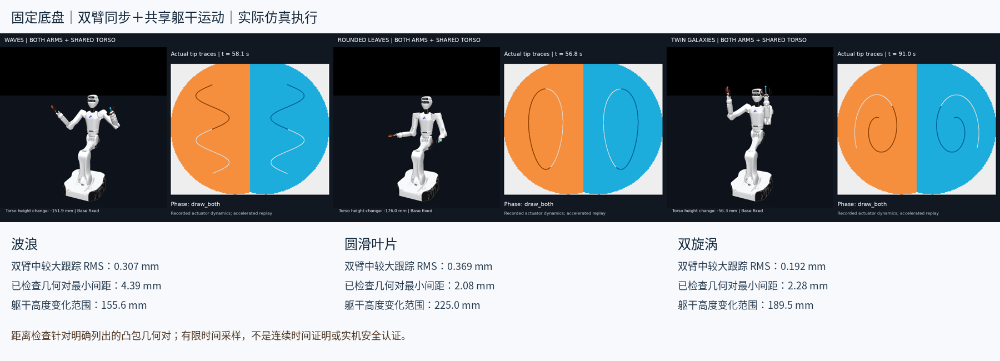

# Astribot drawing: T1 and historical S1

## Latest generic SVG interface: Astribot T1

Start with [`svg_planner/`](svg_planner/README.md): SVG → unchanged geometry → synchronized dual-arm planning with a movable torso and collision checks → MuJoCo validation. The same frozen method/configuration tests all three original SVG inputs: **ginkgo and koi passed; wings was rejected at IK and was not executed**. Includes [agent generation MD](svg_planner/SVG_GENERATION_SPEC.md), tests, [original SVG/PNG test images](svg_planner/inputs/), reports, and [measured trajectory comparison](svg_planner/visuals/three-design-comparison.jpg). Fixed chassis; no hardware-safety certification.

## Execute SVGs in the official T1 simulator

The [simulation SDK adapter](robot_sdk/README.md) connects an existing `simulation-deploy/start-simulation.sh` container to measured-start SVG planning and execution:

```bash
bash robot_sdk/run_sim.sh draw svg_planner/inputs/ginkgo.svg --joint-speed 1.0 --tip-speed 0.2
```

It plans from the current pose, streams at 125 Hz, and stops at the drawing endpoint. Defaults are a 1 rad/s joint command ceiling and a 0.2 m/s tool-tip cruise/command ceiling; duration follows path length, start/stop ramps and joint constraints, with no fixed-time default. Shorter arms slow proportionally to preserve synchronized coupled planning. Every final planned command is checked for sampled geometry, joint velocity and Jacobian tool-tip velocity; live vendor limits still apply. The [feedrate verification](robot_sdk/examples/svg-ginkgo-feedrate-verification.json) records 27.73 seconds of motion and maximum position error of 1.70 mm. Actual received-feedback velocity still has transient overshoot (about 0.223 m/s), so the planning ceiling is not a physical speed guarantee. Simulation command preview and nominal trajectory time are logged separately; the original 2 mm position gate remains. These are joint-feedback FK results, not camera or hardware measurements.

## Earlier T1 case-specific demonstrations

The earlier case-specific implementation is preserved in [`t1/`](t1/). Start with [T1 setup and limitations](t1/T1_README.md), [T1 agent drawing specification](t1/T1_AGENT_DRAWING_SPEC.md), and the recalculated [616 × 560 canvas](t1/t1-canvas/t1-canvas-overview-zh.png). A [larger 1.271 m wingspan regression](t1/T1_WINGS_README.md) adds verified synchronized approach/draw/return beyond the three small examples.

Upstream T1 model assets are downloaded from a pinned official commit, not redistributed here.

The root-level S1 implementation and its original results remain unchanged below for comparison. Do not apply S1 masks or joint trajectories to T1.

---

## Historical S1 implementation

# Astribot synchronous light painting

Fixed-base MuJoCo prototype coordinating a shared moving torso with two synchronized arms. Three agent-generated drawings are preserved as fixed-world targets. This repository includes code, agent instructions, drawing masks, input paths, compact measured results and collision-model audits.

[中文说明与复现步骤](README.zh-CN.md) · [Agent specification v2](agent-spec-v2/AGENT_DRAWING_SPEC.md) · [Reusable prompt](agent-spec-v2/AGENT_PROMPT.zh-CN.md)



## Scope and limitations

- Shared posture-guided torso motion plus compensating arm IK, not a general whole-body optimizer.
- Fixed chassis, synchronized approach/draw/return; human interaction excluded.
- Explicit collision checks use convex hulls and documented mechanical-adjacency exclusions. Sampled clearance is not a continuous-time proof or real-robot safety certification.
- Minimum sampled model clearances are only 2–4 mm. Do not deploy these trajectories directly on hardware.
- The current 570 × 471 canvas remains the earlier neutral-torso design subset, not the enlarged whole-body workspace.
- New drawings require seed IK and torso-posture selection; this is not a plug-and-play planner for arbitrary PNG/JSON inputs.

## Local checks (no model download needed)

Use Python 3.12 and install `requirements.txt` plus `agent-spec-v2/requirements.txt` in an isolated environment. Then:

```bash
python -m compileall -q .
python agent-spec-v2/test_validator.py
python agent-spec-v2/check_backend_inputs.py .
```

## Simulation

Follow the pinned model clone, LFS checksum download and run commands in [README.zh-CN.md](README.zh-CN.md). Set `ASTRIBOT_ASSETS` to an existing pinned descriptions checkout, or place it under `descriptions/`. Run one model at a time to limit memory use. `render_sync.py` needs regenerated full-rate `execution.npz` and expanded model XML; the committed 10 Hz records are summaries, not substitutes for the original 100 Hz checks.

## Results and provenance

`summary.json`, per-design `results.json`, collision pair/exclusion reports, injected-collision controls and the independent final audit describe the tested scope. Videos are accelerated replays of recorded actuator integration, not direct state-setting execution.

Upstream model: [Astribot-Dev/astribot_descriptions](https://github.com/Astribot-Dev/astribot_descriptions), commit `8c651a1abbe2821824a692aa3a3aa4cbf88e4122`. Model meshes are intentionally not vendored. The optional `asset_manifest.json` is also not committed: `download_assets.py` independently reads hashes from the pinned public Git LFS pointers, verifies the downloads, and regenerates this report locally. See [THIRD_PARTY_NOTICES.md](THIRD_PARTY_NOTICES.md) and [UPSTREAM_LICENSE](UPSTREAM_LICENSE).

No new license for original project code has been selected here. The upstream license file applies to upstream material; it must not be interpreted as a blanket license for all original project content.
