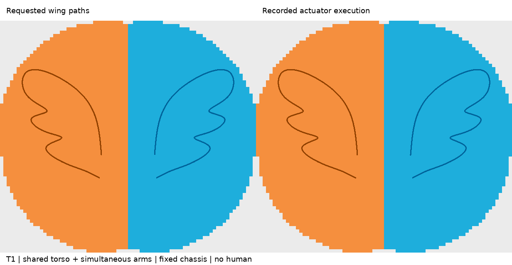

# T1 大幅双翼回归用例

本例扩展已有三组小图；不改变 T1 画布、模型或碰撞豁免，也不覆盖旧用例。无人体，底盘结构固定。每臂一条不中断、不分叉的翼形线，左右臂同一时间进度执行，共享一个活动躯干。

## 几何与复现

- 画布 616 × 560；2.5 mm/px；绘图平面 Y = −0.42 m。
- 双翼总展宽约 1.271 m，单翼包围盒约 0.476 × 0.655 m；每臂弧长约 1.914 m。
- 翼形来自 `make_wings.py` 的固定样条控制点，1001 点等弧长采样；`wing-shape.npy` 保留精确输入，`export_wings.py` 输出有序 JSON、SVG、透明 PNG。
- 羽尖较紧，并非低曲率曲线。仿真采用慢速关节限速时标；不能把这张图片直接解释成硬件可执行指令。

在已有 T1 依赖与官方资产安装完成后，从此目录执行：

```bash
python make_wings.py
python export_wings.py
OPENBLAS_NUM_THREADS=1 python t1_wings.py wings
MUJOCO_GL=egl python render_wings.py
```

`render_wings.py` 读取本地完整 `execution.npz` 和生成的场景；仓库仅发布较小的 10 Hz 回放样本。重新渲染应先重新运行仿真。官方模型网格不随用例重复发布。

## 执行方法与边界

起始状态为关节限位内的近零双臂、预设蹲姿躯干；未验证任意站姿进入这一初始状态。其后不直接赋值/瞬移执行状态：14 维耦合 RRT 寻找双臂就位路线，绘图期间躯干随目标高度移动、两臂补偿，然后熄笔逆向返回初始姿态。所有阶段均纳入同一碰撞对集合。RRT 和总检查使用相同的 0.05 m 距离查询截断；截断距离不是安全裕量。

规划采用 50 ms 时间采样；动力学采用 5 ms 积分、10 ms 碰撞采样。RRT 边检查最大单关节步长 0.01 rad、筛选间距 3 mm；最终整条计划需 ≥2 mm 才进入动力学。有限离散采样不能证明连续时间绝对无碰撞。官方碰撞代理几何及既有接口排除保持不变；不包含接触画笔、力控、真实硬件标定或安全认证。

## 被拒绝的尝试

- 初始躯干高度方案在翼尖附近不可达，保留翼形，改为随高度变化的共享蹲姿。
- 直接从近零双臂进入翼根会与自身碰撞，未执行。
- 左右臂各自找路线再同步合并导致臂间间距不足，未执行。
- 早期耦合路线仍未通过总检查；统一距离查询参数并加密边检查后才允许进入动力学。

详见 `t1-results/wings/results.json`（执行结果）、`planned-curve-audit.json`（几何/时标检查）及独立执行审计。只有实际运行成功的结果才可标记为通过。

## 本次测得结果

- 完整循环 362.90 秒，其中同步绘制 153.70 秒；进入 27.75 秒，熄笔返回 181.45 秒。
- 规划最小采样间距 4.7103 mm；实际最小采样间距 4.7103 mm，出现在返回阶段 338.255 秒，同臂非邻接几何 `collision_t1_geom_083` / `collision_t1_geom_085`。
- 左/右末端最大误差 1.692 / 1.400 mm，RMS 0.143 / 0.117 mm。
- 躯干参考点高度范围 0.819913–0.877519 m（实际升降 57.607 mm）；左右臂最小限位余量 0.03885 / 0.05297 rad。
- MuJoCo 数值警告为零。场景配置了 3947 个显式接触对（尽管通用碰撞掩码为零，显式对仍启用）；`max_contacts = 0` 不能单独证明安全，碰撞结论同时依据显式几何距离检查。
- 单翼包围盒面积分别约为旧叶片、波浪、螺旋的 6.1、8.84、9.86 倍。



[完整周期加速回放](t1-results/wings/sync-replay.mp4)

独立审计复算了 93 个保存状态的末端 FK 与固定底盘，并在报告的最小间距附近 ±50 ms 内按 1 ms 插值复查所有 3947 对。18 个控制关节限位余量均为正；本次观测最大关节速度 0.200074 rad/s、最大数值加速度 2.5799 rad/s²，作为诊断值而非已认证的硬件速度/加速度上限。该局部加密检查不等于全周期连续碰撞证明。最终与初始控制关节的最大差值为 0.000128 rad。
